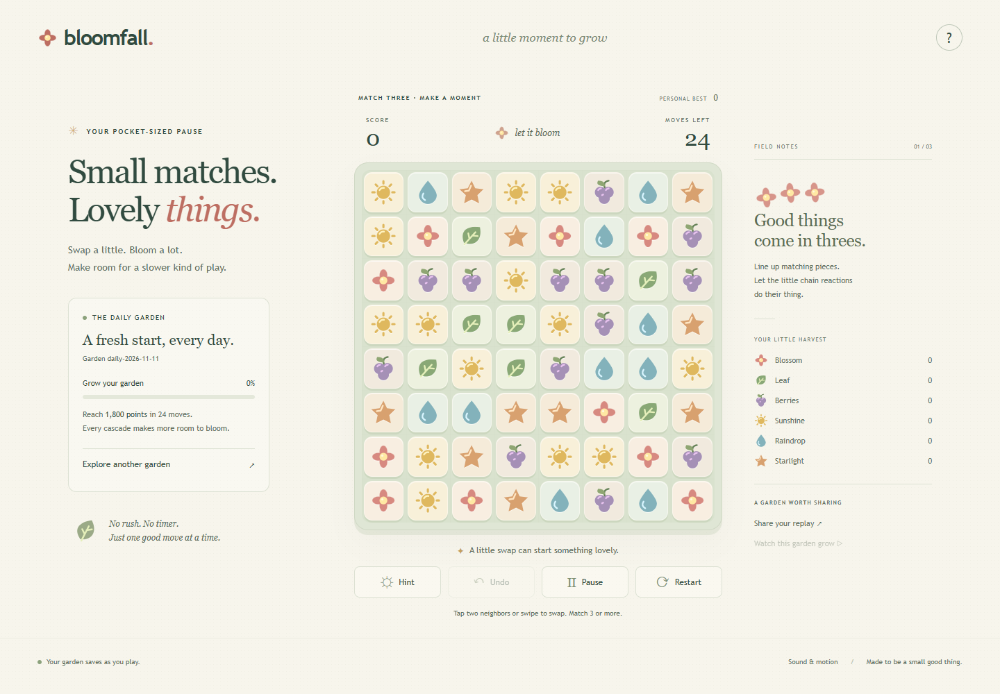

# Bloomfall

A botanical match-three game built with **published GyosJS 0.5.0**, HTML, CSS and JavaScript. One standalone project: no Laravel, backend, account, game engine or remote repository required.



[Mobile preview](docs/evidence/mobile.png)

## Run

Use Node.js 22 or newer, with that version first on `PATH`.

```sh
npm ci
npm run dev
```

Open <http://127.0.0.1:4186>. For a production build:

```sh
npm run build
npm run preview
```

Deploy the contents of `dist/` to a static web host. Use HTTPS for clipboard support. For a subdirectory, build with `npm run build -- --base=/bloomfall/` and serve that directory at the same path. Serve files over HTTP(S); opening `index.html` through `file://` is unsupported. The dev and preview servers are local tools, not production servers.

## Play

- Match at least three pieces horizontally or vertically on an 8 × 8 board. Each matched piece earns 20 points; successive cascades multiply that by 2, 3, and so on.
- Reach 1,800 points within 24 successful moves. Invalid swaps cost no moves. A board without a legal move automatically reshuffles.
- Click/tap neighboring pieces, or swipe one piece toward its neighbor. Scroll the page outside the board; the board captures touch gestures.
- Hold and drag a piece to lift it and preview a neighboring swap. Change direction before releasing; return to the starting point, drop outside the board or press Escape to cancel without spending a move.
- Tab into the board, use arrows to move focus, and Enter/Space to select. Escape clears selection. Shapes and accessible names distinguish pieces independently of color.
- Hint, undo, pause, confirmed restart, daily/random/custom gardens and shareable replay are available. Daily seeds change at midnight **UTC**; an existing saved garden stays until you choose another.
- Sound is off by default. Sound & motion offers synthesized notes and reduced movement; the operating system's reduced-motion setting always wins.

## Saves and replays

Settled moves save to local storage automatically. Reload resumes the last settled board, so reloading halfway through a cascade abandons that unfinished move. Undo and restart update the save. Saves, personal best and preferences belong to the current browser origin; clearing browser storage deletes them. Multiple tabs share that storage, with the last saved game winning.

Replay links contain only a rules version, seed and a maximum of 24 moves. The engine validates and reconstructs them. Watching a replay does not replace your own save; Return to my garden restores your board. An unsupported or damaged link shows a message instead of blocking play. Invalid stored saves recover to a fresh board.

All fonts and artwork are local/system resources. Once loaded, the production game needs no network requests for play. There is **no service worker or guaranteed offline cold start**. If local storage is blocked, the game stays playable in the current tab and reports that saving is unavailable. Sharing a replay provides a portable record of settled moves.

## Verify

```sh
npx playwright install
npm test
npm run build
npm run test:e2e
npm run test:production
```

On Windows the Chromium project uses installed Google Chrome; install it or remove `channel: 'chrome'` from the Playwright configs to use bundled Chromium. Firefox and WebKit use Playwright's browser builds.

The production smoke test starts its own preview on port 4196 and refuses to reuse an unrelated server. Set `BLOOMFALL_PREVIEW_PORT` to another available port if needed.

For lifecycle and performance evidence, run `npm run dev` in one terminal, then `npm run audit:browser` in another. Do not edit application files while measuring: Vite reloads invalidate the run. The audit writes `docs/evidence/browser-audit.json`. Optional `BLOOMFALL_HEAP=1` writes a large, ignored heap snapshot under `.local/` for diagnosis. `BLOOMFALL_URL` can select another Vite dev URL.

See [dogfood findings](docs/GYOSJS-DOGFOOD.md) and [the original plan](docs/PLAN.md). Tests and browser audit helpers are not imported into the production bundle.

## Structure

| File                        | Responsibility                                                                                     |
| --------------------------- | -------------------------------------------------------------------------------------------------- |
| `src/engine.js`             | Seeded random state, legal swaps, scoring, cascades, reshuffles and validated replay               |
| `src/main.js`               | GyosJS scope, reactive view projections, input, animation cancellation, storage and audio lifetime |
| `index.html`                | Keyed board, computed HUD, native dialogs and keyboard-accessible controls                         |
| `src/style.css`             | Responsive botanical UI, SVG piece styling and motion preferences                                  |
| `tests/`                    | Engine invariants, browser flows, production smoke and audit harness                               |
| `scripts/audit-browser.mjs` | Measured DOM identity, response timing and repeated scope teardown                                 |

The authoritative engine state is separate from transient animation frames. No animation callback can commit after its run is cancelled. Changes to random-number consumption, scoring or move rules must preserve old replay semantics or introduce a new replay rules version.

This repository is intentionally local-only at handoff. No remote or publishing workflow has been configured.
